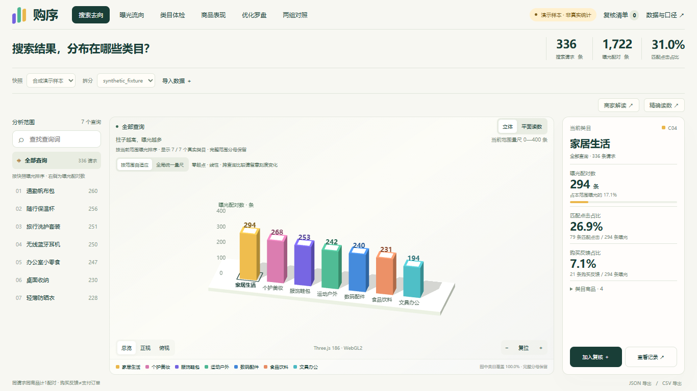
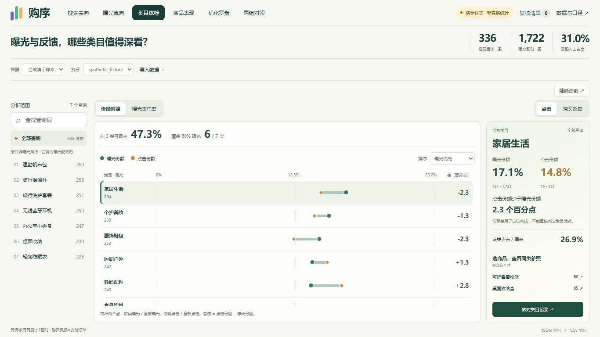

# 购序 · Gouxu

电商搜索反馈的交互式可视化分析工作台。以统一分析范围连接 **搜索 → 类目 → 商品 → 证据 → 复核**，支持 3D、二维精确读数和六个分析入口。

**Vue 3 · TypeScript · Three.js · FastAPI · DuckDB · Parquet · SQLite · Docker**

本开源版以已部署的 **web r18b / API r11** 为源码基准，保留完整业务代码。附带 **336 条合成请求、28 件虚构商品**，下载后即可演示，无需真实数据、账号或 API 密钥。源码核对与整理差异见 [发布说明](docs/RELEASE.md)。



<details>
<summary>查看类目体检：曝光与反馈份额对照</summary>



</details>

## 能做什么

| 页面 | 分析问题 | 呈现方式 |
| --- | --- | --- |
| 搜索去向 | 当前查询的曝光分布到哪些类目？ | 等宽立体柱 / 二维条形读数 |
| 曝光流向 | 类目内哪些商品获得曝光？ | 范围 → 类目 → 商品及余量的流向图 |
| 类目体检 | 曝光与反馈集中在同一批类目吗？ | 份额对照、累计集中度与 K80 |
| 商品表现 | 商品曝光与反馈占比有什么关系？ | 二维数据平面上的立体标记 / SVG |
| 优化罗盘 | 哪些候选商品值得人工检查？ | 曝光矩形树图、同类参照及检查步骤 |
| 两组对照 | 两个冻结查询组有什么差异？ | 共同量尺成对柱、计数与百分点差 |

支持授权日志导入、快照切换、原行证据、服务端复核清单、冻结查询组与 JSON/CSV 导出。3D、2D、详情和导出共用 scope；图中显示数量不会改变完整统计分母。WebGL 不可用时可切换二维读数。

## 快速启动：Docker

需要 Docker Engine / Docker Desktop 和 Compose v2。首次构建需要联网下载镜像及依赖。

```sh
docker compose up --build -d --wait --wait-timeout 180
```

打开 **[http://localhost:8080/?demo=1](http://localhost:8080/?demo=1)**。后端首次启动会自动准备合成快照。

```sh
python tools/smoke.py --base-url http://localhost:8080
docker compose down
```

停止容器保留命名卷中的复核与导入状态。默认只绑定本机 8080；修改端口、服务器部署和备份方式见 [部署说明](docs/DEPLOYMENT.md)。

## 本地开发

需要 **Python 3.12** 和 **Node.js 24**。在项目根目录建立虚拟环境：

```sh
python -m venv .venv
```

Windows PowerShell 激活：`.venv\Scripts\Activate.ps1`；macOS/Linux 激活：`source .venv/bin/activate`。如本机限制脚本执行，直接使用 `.venv\Scripts\python.exe`，无需修改系统策略。

```sh
python -m pip install -r services/api/requirements.lock.txt
python -m uvicorn app.main:app --app-dir services/api --host 127.0.0.1 --port 8000 --no-access-log
```

另开终端：

```sh
cd apps/web
npm ci --no-audit --no-fund
npm run dev
```

打开 **[http://localhost:5173/?demo=1](http://localhost:5173/?demo=1)**。Vite 将 `/api` 请求代理到本机 8000 端口。

## 验证

安装上述依赖后，在根目录运行：

```sh
python tools/check.py
python tools/download_data.py --plan
```

`check.py` 顺序运行原有 Python 领域/契约测试、API 测试、前端领域测试和生产构建；使用合成输入与独立临时状态。也可传 `--python-only` 或 `--frontend-only`。GitHub Actions 已配置相同检查及 Docker 合成 HTTP 冒烟；仓库上传后的远程 CI 结果以实际运行记录为准。

## 项目结构

```text
apps/web/          Vue 界面、Pinia scope、Three.js 与 SVG 图形
services/api/      FastAPI、只读分析查询、导入/导出与状态持久化
contracts/         指标、输入、视图契约与固定数据来源
fixtures/          自建合成演示与边界算例
tools/             检查、HTTP 冒烟、数据下载与全量构建
tests/             Python 领域和契约测试
deploy/            通用 Nginx 配置
docs/              使用、架构、指标、数据与发布说明
```

## 数据与解释边界

- 真实数据目标为 KuaiSearch-Lite，限定 `source.lock.json` 中的两个 Lite 文件。本仓库不含真实日志、派生数据、用户画像或服务器状态。
- Lite 是 2025 历史窗口内连续一个月，具体月份未明确；不代表实时经营。
- 点击和购买反馈都以曝光配对为分母。购买反馈不等于支付订单、销量、GMV 或收益。
- 优化提示用于人工复核；两组对照是描述性比较，均不能确认因果或经营收益。
- 上游数据的 MIT 元数据与论文 CC BY 4.0 声明差异仍保留待核，详见 [数据说明](docs/03_DATA_SOURCES.md)。

## 文档

- [操作指南](docs/USAGE.md) · [指标定义](docs/METRICS.md)
- [工程架构](docs/ARCHITECTURE.md) · [部署说明](docs/DEPLOYMENT.md)
- [源码来源与验证范围](docs/RELEASE.md) · [贡献指南](CONTRIBUTING.md)
- [发布到 GitHub](docs/PUBLISH.md)

## 许可证

本项目原创代码、文档及自建合成样本采用 [MIT License](LICENSE)。第三方软件按各自许可使用；KuaiSearch 原始数据不属于本仓库 MIT 授权范围。详见 [第三方说明](THIRD_PARTY_NOTICES.md)。
