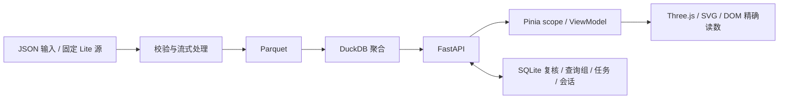

# 工程架构

`apps/web/src/stores/scope.ts` 管理快照、范围、选择、显示预算及异步请求隔离；`api/client.ts` 处理 API 信封、取消与同源操作标记。图形不自行计算另一套分母。

`scenes/core/RendererHost.ts` 管理正交相机、几何、选取与资源释放；`SearchScene.vue` 连接 Three.js、DOM 标签及二维替代。流向、罗盘和类目体检使用 Vue/SVG，诊断与布局公式位于 `domain/`。

`services/api/app/analytics.py` 执行导入、Parquet 与参数化只读分析；`query_cache.py` 管理有界缓存与同键并发合并；`state.py` 管理 SQLite。`main.py` 提供快照、scope、商品、证据、查询组、对照、复核、导入及导出端点。API 描述可通过 `/openapi.json` 获取，交互 Swagger 页面默认关闭。

复核和私有快照按浏览器 cookie 会话隔离。这不是带账号登录、管理员后台和企业权限系统的产品。清除 cookie 会失去原会话入口；部署时应保留状态库并明确自己的访问边界。
